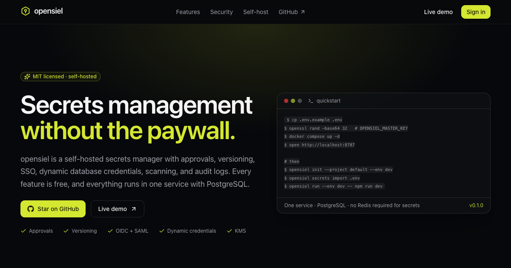
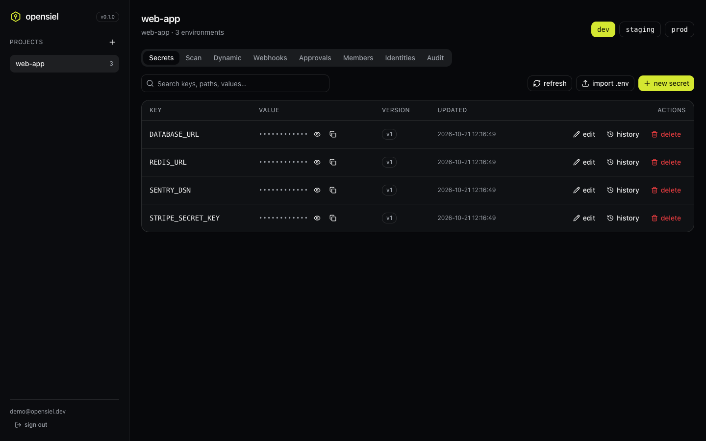
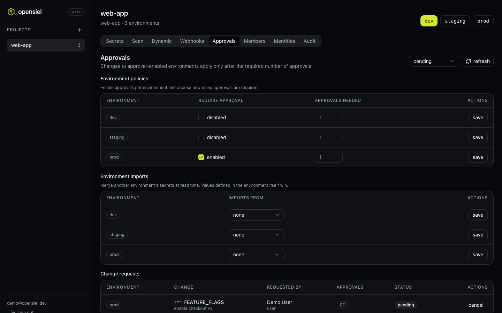
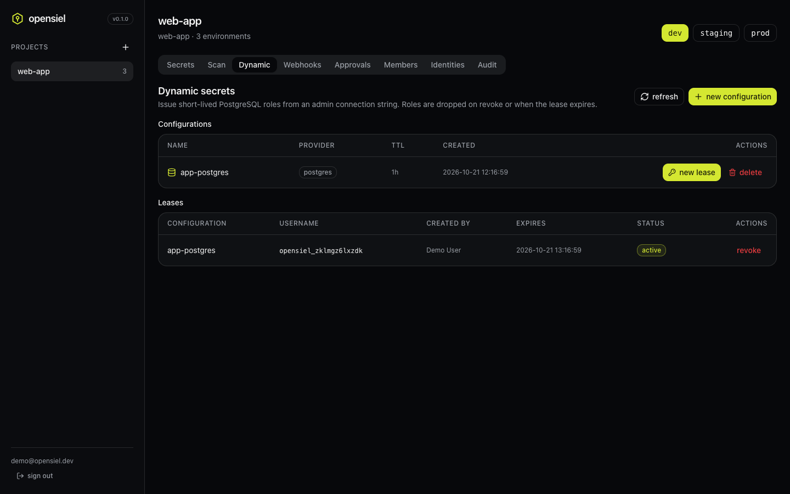
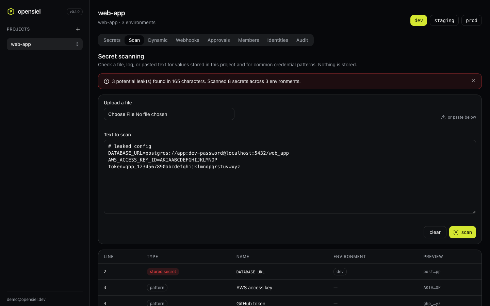
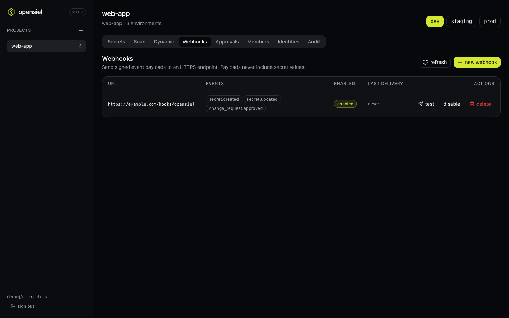
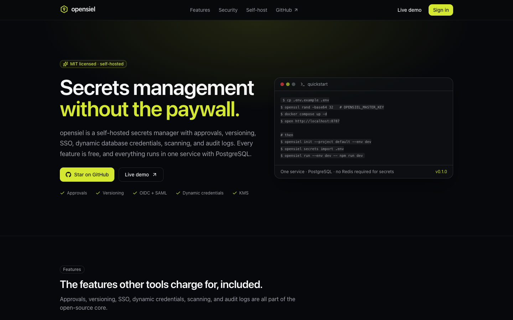
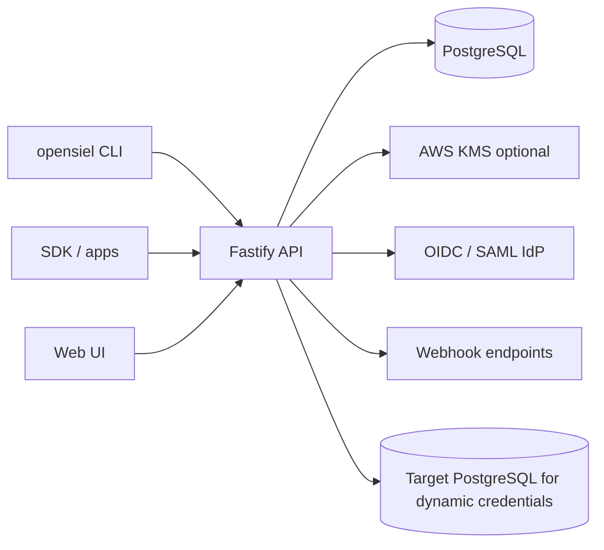

<p align="center">
  
</p>

<h1 align="center">opensiel</h1>

<p align="center">
  <strong>Self-hosted secrets management without the paywall.</strong><br />
  Approvals, versioning, OIDC + SAML, dynamic database credentials, scanning, webhooks,
  external KMS, and audit logs. MIT licensed, one service, PostgreSQL.
</p>

<p align="center">
  <a href="https://github.com/ibrahimhnif/opensiel/actions/workflows/ci.yml"></a>
  
  
  <a href="https://opensiel.liostech.id"></a>
</p>

<p align="center">
  <a href="#quickstart">Quickstart</a> ·
  <a href="#features">Features</a> ·
  <a href="#screenshots">Screenshots</a> ·
  <a href="#architecture">Architecture</a> ·
  <a href="#configuration">Configuration</a> ·
  <a href="docs/README.md">Docs</a> ·
  <a href="https://opensiel.liostech.id">Live demo</a>
</p>

---

opensiel is a small, readable secrets manager you can run yourself. It is built for teams
that want Infisical-style workflows — environments, versioned secrets, approvals, machine
identities, SSO — without an enterprise plan, and without handing secrets to a SaaS.

The core is MIT licensed. There is no license server, no phone-home gate, and no feature
flag that unlocks a paid tier.

> **Live demo:** <https://opensiel.liostech.id> — `demo@opensiel.dev` / `demo-password-123`
> (read-only shared account).

## Documentation

Hosted docs: <https://opensiel.liostech.id/docs/> (the same pages are in [`docs/`](docs/)).

| Guide                                                           | What it covers                                     |
| --------------------------------------------------------------- | -------------------------------------------------- |
| [Getting started](docs/getting-started.md)                      | Docker Compose, owner account, invites, CLI.       |
| [Local development](docs/local-development.md)                  | Monorepo setup, dev servers, tests, seeding.       |
| [Configuration](docs/configuration.md)                          | Every env var, OIDC/SAML, AWS KMS, rotation.       |
| [CLI](docs/cli.md) · [SDK](docs/sdk.md)                         | Inject secrets and integrate apps.                 |
| [Use cases](docs/use-cases.md)                                  | CI/CD, Kubernetes, dynamic credentials, approvals. |
| [CI/CD](docs/ci-cd.md)                                          | GitHub Actions and GitLab recipes.                 |
| [Kubernetes](docs/kubernetes.md)                                | Deploy, TLS, pod injection, scaling.               |
| [Operations](docs/operations.md)                                | Backups, restore, rotation, monitoring.            |
| [Troubleshooting](docs/troubleshooting.md) · [FAQ](docs/faq.md) | Common errors and answers.                         |

## Features

|                             |                                                                                                                                                         |
| --------------------------- | ------------------------------------------------------------------------------------------------------------------------------------------------------- |
| **Projects & environments** | Group secrets by project, environment (`dev`, `staging`, `prod`, or custom), and folder path.                                                           |
| **Versioning & rollback**   | Every write is an immutable version. Roll back creates a new version and keeps history.                                                                 |
| **Approvals**               | Opt-in per environment. Writes, deletes, and rollbacks become change requests that need N approvals from owners/admins; requesters cannot self-approve. |
| **Team management**         | Email invites, roles (`owner`, `admin`, `member`, `viewer`), last-owner protection, session revocation on removal.                                      |
| **Scoped roles**            | Custom roles with project/environment/path grants and optional expiry, layered on built-in roles.                                                       |
| **Machine identities**      | Client credentials, trusted JWTs (Kubernetes/CI OIDC), AWS SigV4, short-lived tokens, environment scopes.                                               |
| **References & imports**    | `${KEY}` / `${/path/KEY}` resolution and cross-environment imports, resolved at read time.                                                              |
| **Bulk import**             | Paste or upload a `.env` (or flat JSON); existing keys get a new version.                                                                               |
| **SSO**                     | OIDC (authorization code + PKCE) and SAML (signed assertions), with invite-based or automatic organization provisioning.                                |
| **MFA**                     | TOTP with single-use recovery codes, per-organization enforcement for password logins.                                                                  |
| **Secret scanning**         | Scan pasted text or files for stored secrets and common credential patterns, with masked findings.                                                      |
| **Dynamic credentials**     | Issue short-lived PostgreSQL roles with a TTL; revoke manually or let the reaper drop them at expiry.                                                   |
| **Secret rotation**         | Schedule static-secret rotation with dual-phase rollover (PostgreSQL roles or an HTTP rotator), grace windows, and retries.                             |
| **Secret syncs**            | Push an environment to AWS/GCP/Azure, Vercel, Cloudflare, GitHub Actions, Kubernetes, or a webhook on a schedule.                                       |
| **End-to-end encryption**   | Opt-in per project: keys stay client-side; the server stores only ciphertext and metadata.                                                              |
| **Webhooks**                | HMAC-SHA256 signed event deliveries with retries and delivery status.                                                                                   |
| **Master key rotation**     | Rewrap project data keys to a new KEK without re-encrypting secrets; optional AWS KMS.                                                                  |
| **Audit log**               | Writes, reads, rollbacks, SSO logins, leases, and webhooks — values are never recorded.                                                                 |
| **CLI & SDK**               | `opensiel run --env dev -- npm run dev`, `opensiel secrets import .env`, and `@liostech/opensiel-sdk`.                                                  |

## Quickstart

### One command

```bash
curl -fsSL https://opensiel.liostech.id/install.sh | bash
```

The installer checks Docker, generates the keys, and starts PostgreSQL and opensiel in
`~/.opensiel`. Open <http://localhost:8787>; the first signup becomes the owner.

Options: `--port`, `--dir`, `--version`, `--url`, `--no-start`. With `curl | bash`, pass them
after `bash -s --`, for example:

```bash
curl -fsSL https://opensiel.liostech.id/install.sh | bash -s -- --port 9000
```

### From source

```bash
git clone https://github.com/ibrahimhnif/opensiel.git
cd opensiel

cp .env.example .env
openssl rand -base64 32   # set OPENSIEL_MASTER_KEY
openssl rand -hex 32      # set OPENSIEL_JWT_SECRET

docker compose --env-file .env -f deploy/docker-compose.yml up -d --build
open http://localhost:8787
```

The first account becomes the instance owner. Then turn off open signup (see
[Configuration](#configuration)) and invite your team from the **Members** tab.

### CLI

```bash
npm install -g @liostech/opensiel-cli

opensiel login --api-url http://localhost:8787
opensiel init --project default --env dev
opensiel secrets import .env
opensiel run --env dev -- npm run dev
```

### SDK

```bash
npm install @liostech/opensiel-sdk
```

```ts
import { OpensielClient } from "@liostech/opensiel-sdk";

const client = new OpensielClient({ apiUrl: "http://localhost:8787" });
await client.loginWithClientCredentials(clientId, clientSecret);

const { secrets } = await client.listSecrets(projectId, "dev");
```

### GitHub Actions

```yaml
- uses: ibrahimhnif/opensiel@v0.1.0
  with:
    api-url: https://opensiel.example.com
    project: web-app
    env: prod
    client-id: ${{ secrets.OPENSIEL_CLIENT_ID }}
    client-secret: ${{ secrets.OPENSIEL_CLIENT_SECRET }}
```

Exports root-folder secrets to `GITHUB_ENV`, with values masked in the log. Set `output-file`
if a dotenv file is needed.
See [CI/CD](docs/ci-cd.md#reusable-github-action) for the inputs and outputs.

## Screenshots

| Dashboard                                    | Approvals                                    |
| -------------------------------------------- | -------------------------------------------- |
|  |  |

| Dynamic credentials                                  | Secret scanning                        |
| ---------------------------------------------------- | -------------------------------------- |
|  |  |

| Webhooks                                   | Landing                                  |
| ------------------------------------------ | ---------------------------------------- |
|  |  |

## Architecture



- **API + UI**: one Fastify service serves `/api/*` and the built React app.
- **Database**: PostgreSQL stores users, projects, wrapped data keys, secret versions,
  change requests, leases, webhooks, and audit entries.
- **Crypto**: AES-256-GCM envelope encryption. A master key (env or AWS KMS) wraps one data
  key per project; secret versions are encrypted with that project key.
- **Auth**: argon2id passwords, hashed session tokens, short-lived machine JWTs, OIDC/SAML
  with a shared provisioning path.

See [docs/architecture.md](docs/architecture.md) for the data model, flows, and threat model.

## Configuration

| Variable                      | Default   | Purpose                                                                      |
| ----------------------------- | --------- | ---------------------------------------------------------------------------- |
| `DATABASE_URL`                | required  | PostgreSQL connection string.                                                |
| `OPENSIEL_MASTER_KEY`         | required* | 32-byte base64 key that wraps project data keys.                             |
| `OPENSIEL_MASTER_KEY_VERSION` | `1`       | Version of the current master key.                                           |
| `OPENSIEL_JWT_SECRET`         | required  | 32+ chars, signs machine tokens and SSO cookies.                             |
| `OPENSIEL_PUBLIC_URL`         | –         | Public URL, used for cookies and SSO callbacks.                              |
| `OPENSIEL_ALLOW_SIGNUP`       | `false`   | Allow new signups after the first account.                                   |
| `OPENSIEL_OIDC_*`             | –         | OIDC issuer, client id/secret, scopes, domain allowlist, auto-create.        |
| `OPENSIEL_SAML_*`             | –         | SAML entry point, IdP certificate, issuer, audience, allowlist, auto-create. |
| `OPENSIEL_KMS_*`              | –         | AWS KMS key id, wrapped master key, region, endpoint, credentials.           |
| `OPENSIEL_MASTER_KEY_NEXT`    | –         | Next KEK for rotation.                                                       |

\* not required when AWS KMS is configured. See [.env.example](.env.example) and the
[SSO](docs/architecture.md#sso) and [KMS](docs/architecture.md#external-kms) sections.

## Self-hosting

The published image is `ghcr.io/ibrahimhnif/opensiel`. The Helm chart is the recommended
Kubernetes path; raw manifests in [`deploy/k8s`](deploy/k8s) work without Helm. See
[Kubernetes](docs/kubernetes.md) for both.

```bash
kubectl apply -f deploy/k8s/namespace.yaml
kubectl apply -f deploy/k8s/postgres.yaml
kubectl -n opensiel create secret generic opensiel-secrets \
  --from-literal=DATABASE_URL='postgres://opensiel:<pw>@postgres.opensiel.svc.cluster.local:5432/opensiel' \
  --from-literal=OPENSIEL_MASTER_KEY="$(openssl rand -base64 32)" \
  --from-literal=OPENSIEL_JWT_SECRET="$(openssl rand -hex 32)" \
  --from-literal=OPENSIEL_PUBLIC_URL='https://opensiel.example.com' \
  --from-literal=OPENSIEL_ALLOW_SIGNUP='true'
kubectl apply -f deploy/k8s/app.yaml -f deploy/k8s/ingress.yaml
```

After the first account is created, set `OPENSIEL_ALLOW_SIGNUP=false` and restart.

## Security

- AES-256-GCM envelope encryption, per-project data keys, AAD bound to secret id + version.
- argon2id password hashes; only SHA-256 of session and machine secrets is stored.
- Scoped, short-lived machine tokens; requesters cannot approve their own changes.
- Webhook payloads never include secret values; scan findings are masked.
- Master key rotation and optional AWS KMS support.

Read [SECURITY.md](SECURITY.md) for the threat model and how to report an issue.

## Roadmap

MFA, PKI/SSH certificate issuance, SCIM, and provider plugins.

## Contributing

Issues and pull requests are welcome. Start with [CONTRIBUTING.md](CONTRIBUTING.md); the test
suite needs only Node 22, pnpm, and a PostgreSQL 16 database.

## License

[MIT](LICENSE) © opensiel contributors.
